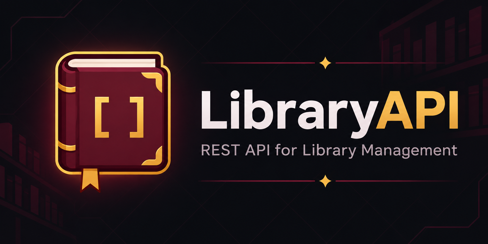
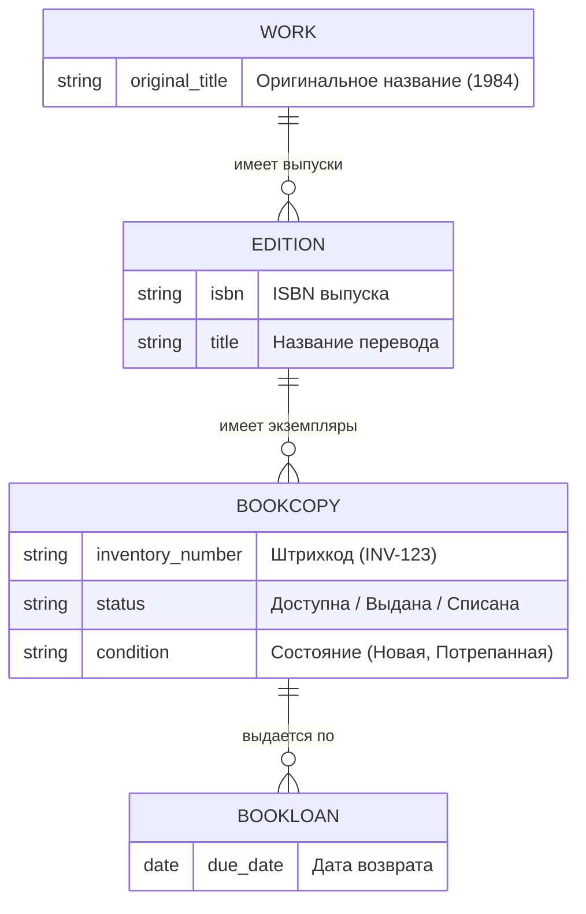

<div align="center">
  
</div>

<div align="center">


</div>

# 📚 LibraryAPI

Современный REST API для управления библиотекой, разработанный на Django Rest Framework. 
Проект спроектирован с учетом реальных библиотечных бизнес-процессов: от абстрактного произведения до конкретного физического экземпляра на полке.

## ✨ Главная особенность архитектуры

Вместо того чтобы хранить абстрактные счетчики ("всего 5 книг, доступно 2"), система использует трехуровневую модель, как в настоящих библиотеках:



## 🛡️ Аудит и история изменений

В проекте настроен полноценный журнал аудита (Audit Trail) с использованием `django-simple-history`. 
Любые изменения (создание, обновление, удаление) таких сущностей, как Издания, Книги, Авторы, Пользователи и Выдачи, автоматически логируются.

*   **Кто изменил:** Система фиксирует пользователя, сделавшего запрос через API или админку.
*   **Когда изменил:** Точная дата и время.
*   **Что изменил:** Хранится история "было/стало" для каждого поля.

Историю можно просмотреть прямо в панели администратора Django, нажав кнопку **"History"** в карточке любого объекта.

## 📚 Стек технологий
- Python 3.14 / Django 6.1 / DRF
- PostgreSQL 16 (База данных)
- Poetry (Управление зависимостями)
- Docker / Docker Compose / Nginx / Gunicorn
- drf-spectacular (OpenAPI 3.0)
- django-filter, Simple JWT

## 📖 Документация и запуск
Вся подробная информация по локальному запуску, настройке переменных окружения, развертыванию через Docker и загрузке тестовых данных перенесена в отдельное руководство:

👉 **[Перейти к руководству по установке и запуску](docs/SETUP.md)**

## 🔑 Основные эндпоинты

### 📖 Документация API
* `/api/docs/` — Swagger UI документация
* `/api/schema/` — OpenAPI схема

### Аутентификация
* `POST /api/user/register/` — регистрация нового читателя
* `POST /api/user/token/` — получение JWT (email, password)
* `POST /api/user/token/refresh/` — обновление access токена

### Пользователи
* `GET /api/user/` — список пользователей (только библиотекарь)
* `GET /api/user/{id}/` — конкретный пользователь (владелец или библиотекарь)
* `PATCH/PUT /api/user/{id}/` — редактирование профиля
* `DELETE /api/user/{id}/` — деактивация (только библиотекарь)
* `GET /api/user/me/` — свой профиль

### Каталог
* `GET/POST /api/catalog/authors/` — список/создание авторов
* `GET/PUT/PATCH/DELETE /api/catalog/authors/{id}/` — операции с автором
* `GET/POST /api/catalog/genres/` — жанры
* `GET/POST /api/catalog/publishers/` — издательства
* `GET/POST /api/catalog/works/` — произведения (Work)
* `GET/POST /api/catalog/editions/` — конкретные издания (Edition)
* `POST /api/catalog/editions/{id}/add_copies/` — сгенерировать новые экземпляры для издания
* `GET/POST /api/catalog/copies/` — управление конкретными физическими экземплярами (BookCopy)

### Выдача книг
* `GET/POST /api/lending/` — список/создание выдач
* `POST /api/lending/{id}/return/` — возврат книги

## 🔒 Роли и права доступа

* `Читатель` — может просматривать каталог, свои выдачи, редактировать свой профиль.
* `Библиотекарь` — полный доступ к каталогу, выдаче, списку пользователей.

## 🏗️ Структура проекта

```
LibraryAPI/
├── config/                      # Основные настройки Django
│ ├── settings.py
│ ├── urls.py
│ └── wsgi.py
├── users/                       # Пользователи: регистрация, профиль, JWT
│ ├── models.py                  # CustomUser
│ ├── serializers.py
│ ├── views.py
│ ├── permissions.py
│ └── urls.py
├── catalog/                     # Каталог: произведения, издания, экземпляры
│ ├── models.py                  # Work, Edition, BookCopy, Author, Genre, Publisher
│ ├── serializers.py
│ ├── views.py
│ ├── admin.py
│ └── urls.py
├── lending/                     # Выдача книг
│ ├── models.py                  # BookLoan
│ ├── serializers.py
│ ├── views.py
│ └── urls.py
├── docs/                        # Документация
│ ├── artwork/                   # Картинки и баннеры
│ └── SETUP.md                   # Подробная инструкция по запуску
├── .env.example                 # Пример переменных окружения
├── Dockerfile
├── docker-compose.yml
├── pyproject.toml               # Зависимости и настройки линтеров
├── manage.py
└── README.md
```

## 📜 Лицензия

Этот проект распространяется под [лицензией MIT](LICENSE).